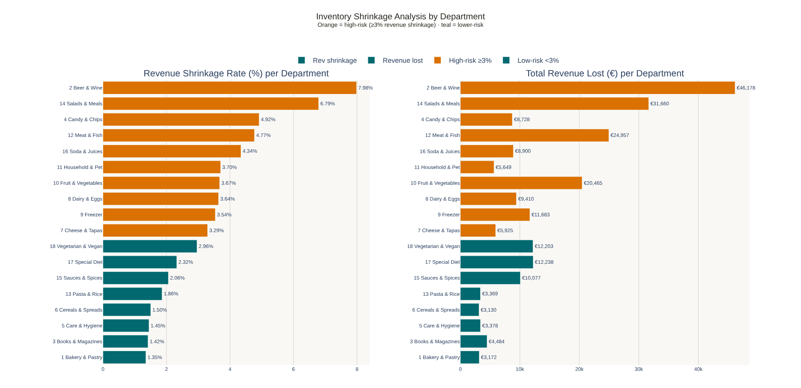

# Catching What Self-Checkout Misses: Fraud Detection for a Supermarket Chain

**Author:** Francisca (Kika) Freixo  

An unsupervised anomaly-detection system that ranks self-checkout shopping sessions by how likely they are to contain theft, so staff can spot-check the right customers instead of picking at random.

**Python · pandas · scikit-learn (Isolation Forest, LOF, PCA, K-Means) · Plotly · R**

---

## The problem
A supermarket chain ("AHA") rolled out self-scan checkout. Queues fell by 68%, but shrinkage (lost stock) rose from **11% to 14% in one year**. Fraud now hides inside ordinary shopping behaviour, and there are **no fraud labels** to train a classifier on.

## What I built (team of 6)
1. **Exploratory analysis of 100,000 shopping sessions** to define what *honest* shopping looks like: time between scans, movement through the store, dwell time per department and basket value.
2. **Feature engineering**: 24+ behavioural features per session, including Manhattan travel distance on the store grid, "jump ratio", scan-speed entropy, share of high-value items, and department-level shrinkage and missing-stock risk.
3. **Hybrid anomaly ensemble**:
   - an ensemble of **27 Isolation Forests** trained on verified fraud-free cashier data
   - **Local Outlier Factor** refinement against each session's nearest behavioural peers
   - **PCA reconstruction error** (90% explained variance)
   - **K-Means** shopper profiles (k chosen by silhouette score)
   - a weighted final score that adds EDA-derived business risk, with the top 150 sessions flagged for checks



## Results
| | |
|---|---|
| Share of annual shrinkage recovered (validation set) | **24.6%** |
| Estimated revenue recovered per year | **≈ €55,500** of €225,600 lost |
| 4-year net gain / IRR | **€68,946 / 65%**, payback < 12 months |

K-Means found three shopper profiles: *Everyday Essentials* (38%), *Slow / Distracted* (45%) and *High-Risk Department* shoppers (17%), whose scans fall 74.7% in theft-prone departments.

The recommendation was a three-phase rollout: a silent pilot, then model-directed checks, then full deployment with retraining. A low-cost deterrence message on each terminal complements the model.

## Repository structure
```
src/fraud_detection_model.py        # full pipeline: features -> ensemble -> ranked output
notebooks/eda_shopping_behaviour.ipynb  # EDA report (Python/Plotly)
notebooks/eda_items_and_baskets.Rmd     # item and basket-level EDA (R)
images/                              # figures used in this README
```

## Running it
```bash
pip install pandas numpy scikit-learn
# put the course data files in data/ (see data/README.md)
python src/fraud_detection_model.py   # writes ranked sessions to output/
```

*Maastricht University, eLab Business Case II (2026). The dataset was provided by the course and is not included.*
